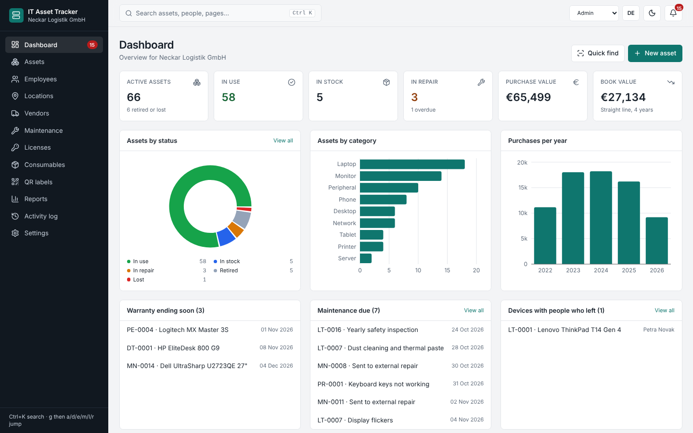

# IT Asset & Inventory Tracker

A web app for an IT team to keep track of company devices: who has what, where it is, how old it is, when the warranty ends and what maintenance is due. The demo data belongs to a made-up company, so it can be tried without any account.

## Live
- **Demo (no login, data stays in your browser):** https://it-asset-tracker-seven.vercel.app
- **Version with database and login (Supabase):** https://it-asset-tracker-pjz3.vercel.app
- Source: https://github.com/RamizLilo/it-asset-tracker



## Features
- **Dashboard** with key numbers, charts and alerts (warranty ending, maintenance due, devices with people who left)
- **Assets:** search, filters, sorting, column picker, table and card view, bulk changes, CSV import and export, check out / check in, duplicate, history per device
- **Asset detail:** purchase price, book value (straight-line depreciation), warranty, maintenance, notes, QR label
- **Employees, locations, vendors** with the devices and spending linked to each
- **Maintenance:** open, overdue and done work with costs
- **Licenses:** seats, who uses a seat, expiry
- **Consumables:** stock with reorder level and quick +/-
- **QR labels:** pick devices and print an A4 sheet
- **Reports:** by department, cost by category, warranty, depreciation and replacement, maintenance cost, idle devices (CSV or print)
- **Activity log:** every change with user and time
- **Settings:** company, currency, depreciation years, alert days, JSON backup and restore
- **Roles** (Admin, Technician, Viewer), **English / German**, **light / dark**, command palette (Ctrl+K), keyboard jumps (g then a, d, e, m, l, r)

## Tech
Next.js (App Router), React, Tailwind CSS, Recharts, qrcode. Data is saved in the browser (localStorage). There is a single data layer (`lib/store.jsx` and `lib/reducer.js`), so a database such as Supabase can replace it later.

## Database (optional)
By default the app runs in demo mode (data in the browser). To use a real database with login and roles, follow `docs/supabase-setup.md`. The schema is in `supabase/schema.sql` and the security rules (Row Level Security) are part of it.

## Run locally
```
npm install
npm run dev
```
Open http://localhost:3000. To start again with the demo data: Settings, then "Restore demo data".

## Notes
- All names, companies and prices in the demo data are made up.
- Demo mode: the roles only change what the interface allows. Live mode: login with Supabase, and the roles are enforced in the database (Row Level Security).
